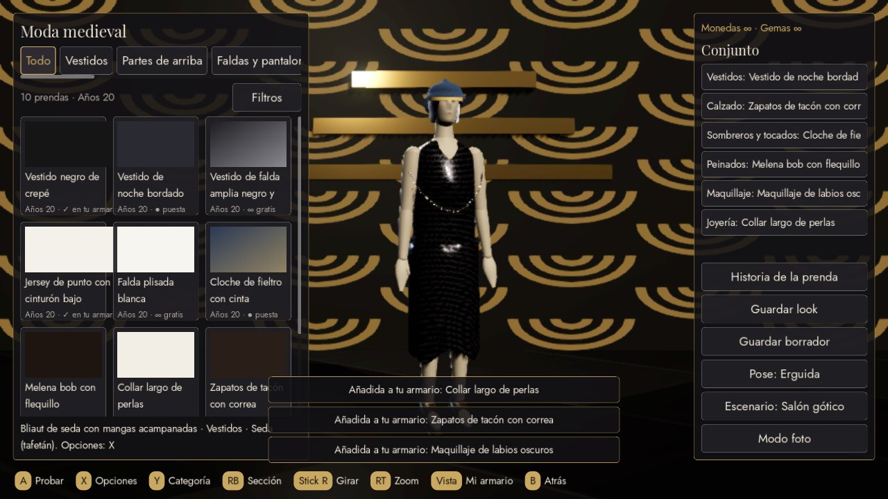
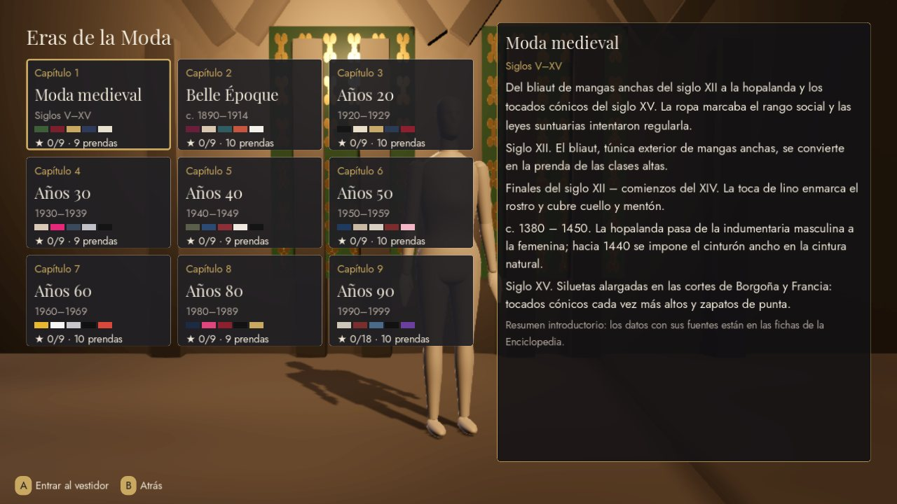
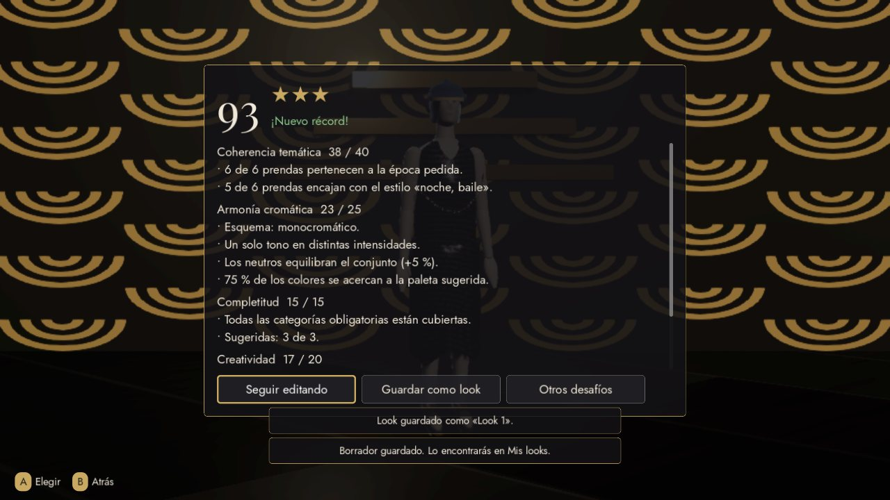
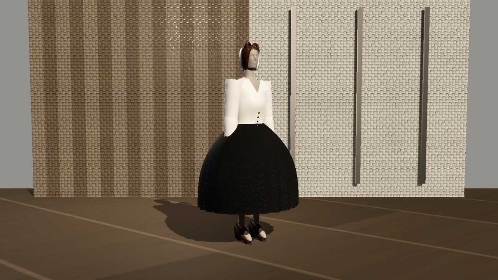
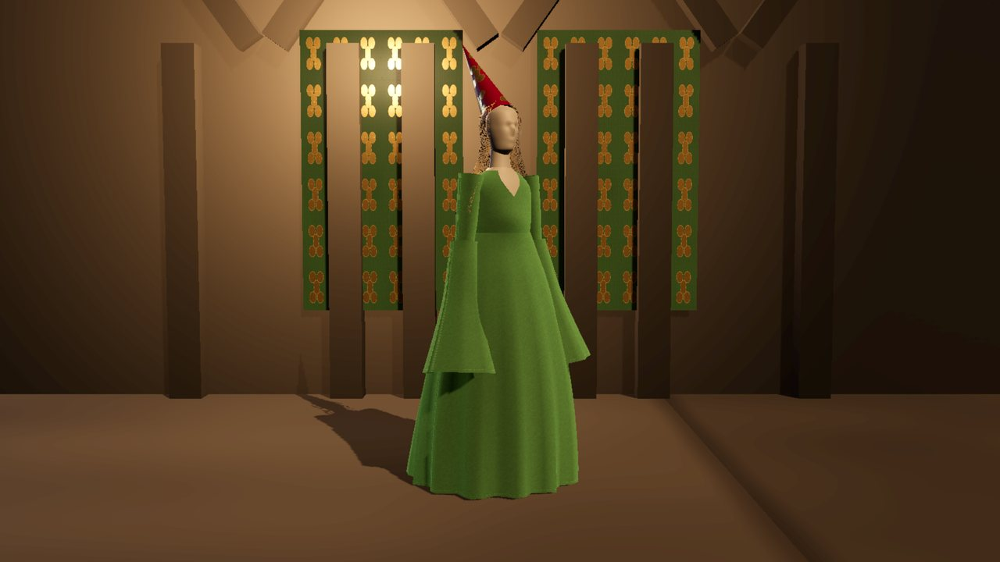

# Atelier de las Eras (título provisional)

Juego **original** de moda e historia del vestido, diseñado para Nintendo Switch (modos sobremesa
y portátil) y desarrollado con Godot 4.7.2. Funciona **sin conexión**, con **monedas y gemas
ilimitadas**, sin anuncios ni compras.



> **Aviso.** Este repositorio no contiene código, arte, personajes, interfaz ni ningún otro recurso
> de *SUITSME* ni de Zirafit Limited, y no está afiliado a ellos. La auditoría del APK original
> demostró que un port directo no es viable sin el proyecto fuente y la licencia de Zirafit
> ([informe](docs/01-informe-viabilidad-apk.md)). El nombre del repositorio es histórico; se
> recomienda renombrarlo para evitar confusiones con esa marca.

## Qué incluye

- **Eras de la Moda:** 9 capítulos (medieval, Belle Époque, años 20, 30, 40, 50, 60, 80 y 90), cada
  uno con su escenario, etapas, prendas y desafíos.
- **86 prendas originales** generadas en 3D con tejidos PBR (seda, satén, terciopelo, denim,
  cuero, encaje, lentejuelas…), costuras, pliegues y caída, sobre un maniquí articulado.
- **HISTORIA DE LA PRENDA:** 40 fichas con 105 afirmaciones marcadas como verificadas, discutidas o
  interpretaciones, y 59 fuentes institucionales.
- **30 desafíos** con evaluación local transparente y alternativas ilimitadas.
- Looks, borradores, historial, papelera, galería de fotos, filtros completos del armario.
- Guardado atómico con SHA-256, copias de seguridad y recuperación automática.
- Controles de Joy-Con y Pro Controller por letra de botón, táctil, ratón y teclado; perfiles
  sobremesa (1920×1080) y portátil (1280×720) con resolución dinámica.

| | |
|---|---|
|  |  |
|  |  |

## Empezar

- **Jugar:** descarga el artefacto *atelier-de-las-eras-escritorio* de la última ejecución de CI
  (pestaña Actions) o abre `game/project.godot` con Godot 4.7.2 y pulsa F5.
- **Tutorial completo:** [docs/TUTORIAL.md](docs/TUTORIAL.md).
- **Estado verificado de cada requisito:** [docs/00-estado.md](docs/00-estado.md).

## Documentación

| Documento | Contenido |
|---|---|
| [01 Informe de viabilidad del APK](docs/01-informe-viabilidad-apk.md) | Auditoría de SUITSME 0.13272 y veredicto |
| [02 Estrategia técnica](docs/02-estrategia-tecnica.md) | Motor, arquitectura, sin conexión |
| [03 Diseño del juego](docs/03-diseno-del-juego.md) | Modos, economía, evaluación, guardado |
| [04 Mejoras de jugadores](docs/04-mejoras-de-jugadores.md) | Los 10 requisitos y su evidencia |
| [05 Enciclopedia](docs/05-enciclopedia-metodologia.md) | Metodología y correcciones |
| [06 Nintendo Switch](docs/06-nintendo-switch.md) | Controles, perfiles, requisitos externos |
| [07 Pruebas y calidad](docs/07-pruebas-y-calidad.md) | Pruebas, errores corregidos, rendimiento |
| [08 Circuito de arte](docs/08-pipeline-de-arte.md) | Del procedural a la producción |
| [Eras de la Moda](docs/eras/README.md) | Capítulos generados desde los datos |
| [Licencias de terceros](docs/LICENCIAS-TERCEROS.md) | Godot (MIT), tipografías (OFL) |

## Pruebas

```bash
python -m pytest tools/tests -q
```

```bash
godot --headless --path game -s res://tests/run_tests.gd
```

22 pruebas de herramientas, 58 pruebas del juego y un recorrido de integración de 28
comprobaciones en sobremesa y portátil, todos en verde; la CI los repite en cada cambio.
