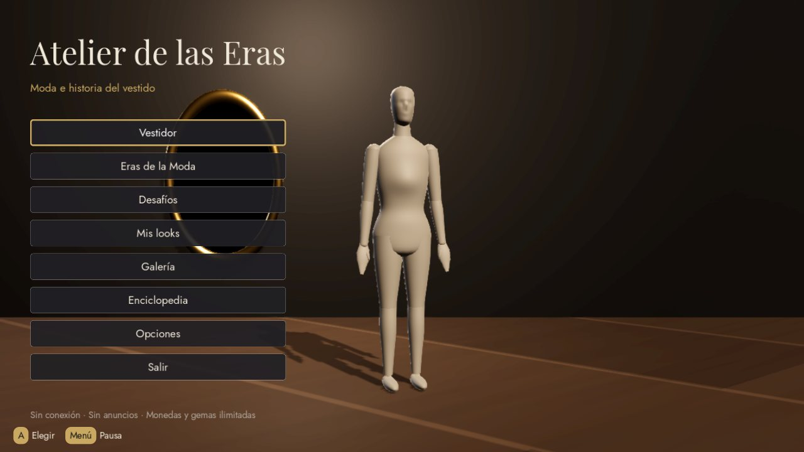
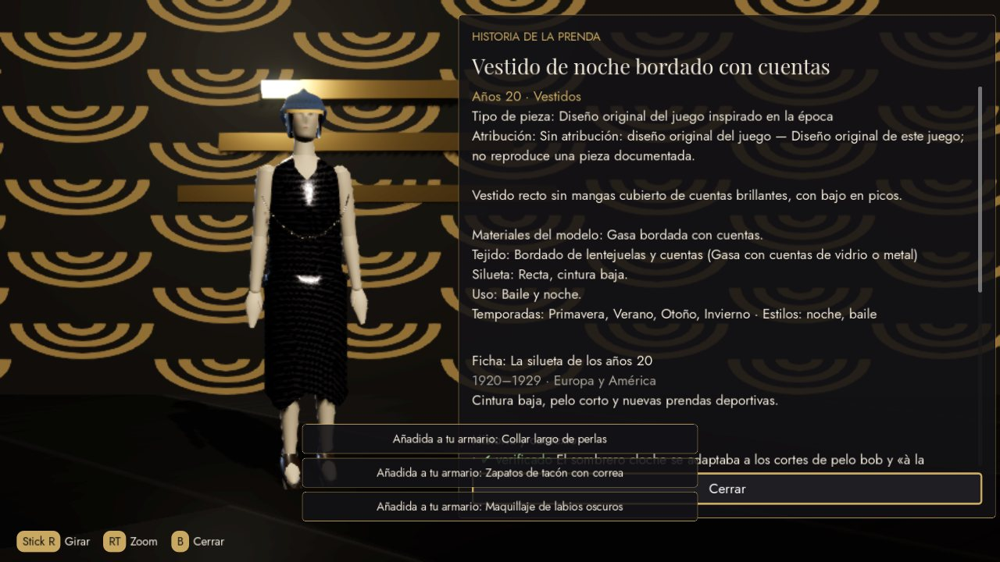

# Tutorial completo: Atelier de las Eras

Guía paso a paso para personas que empiezan. Los comandos de Windows se escriben en **PowerShell**;
los de macOS y Linux, en la **Terminal**.

> **La forma más rápida de jugar:** abre la pestaña **Actions** del repositorio en GitHub, entra en
> la última ejecución verde de «CI» y descarga el artefacto **atelier-de-las-eras-escritorio**.
> Dentro están `windows/AtelierDeLasEras.exe` y `linux/AtelierDeLasEras.x86_64`.
>
> **En una Switch con CFW:** descarga de la misma ejecución el artefacto
> **atelier-de-las-eras-switch-nro** y sigue la [sección 10.1](#101-switch-con-cfw-nro-homebrew).



---

## 1. Acceso a GitHub

1. Entra en <https://github.com> e inicia sesión con la cuenta propietaria del repositorio.
2. Abre el repositorio `bastianjavalv/Suits-me`.
3. Pestañas útiles:
   - **Code**: los archivos.
   - **Pull requests**: los cambios propuestos (aquí está el trabajo de esta entrega).
   - **Actions**: las comprobaciones automáticas y los ejecutables descargables.
4. El repositorio es **público**: nunca subas APK, recursos de otros juegos ni contraseñas. El
   verificador automático lo bloquea, pero la responsabilidad final es tuya.

## 2. Estructura del repositorio

```text
Suits-me/
├── game/                  Proyecto de Godot (el juego)
│   ├── data/              Contenido editable: prendas, enciclopedia, desafíos, economía…
│   ├── src/               Código (core, render, platform, ui)
│   ├── shaders/           Materiales de tejidos, maniquí y suelos
│   ├── assets/fonts/      Tipografías con licencia OFL
│   └── tests/             Pruebas unitarias y de integración
├── switch/                NRO homebrew para Switch: port de Godot (motor/) y scripts de compilación
├── tools/                 Herramientas en Python (auditoría de APK, validadores, documentación)
├── docs/                  Documentación (este tutorial, informes, capturas)
│   └── eras/              Capítulos generados desde los datos
└── .github/workflows/     Comprobaciones automáticas (CI)
```

## 3. Descarga y clonación

**Opción A, sin instalar nada:** en GitHub, botón verde **Code → Download ZIP** y descomprime.

**Opción B, con Git (recomendada para editar):**

1. Instala Git desde <https://git-scm.com/download/win> (deja las opciones por defecto).
2. Abre PowerShell en la carpeta donde quieras el proyecto y ejecuta:

```powershell
git clone https://github.com/bastianjavalv/Suits-me.git
```

```powershell
cd Suits-me
```

3. Para trabajar con la rama de esta entrega (mientras el PR no esté fusionado):

```powershell
git checkout claude/charming-dirac-hc1ja1
```

## 4. Instalación de herramientas

| Herramienta | Para qué | Dónde |
|---|---|---|
| Godot 4.7.2 (versión estándar, no .NET) | Abrir, probar y exportar el juego | <https://github.com/godotengine/godot/releases/tag/4.7.2-stable> → `Godot_v4.7.2-stable_win64.exe.zip` |
| Python 3.8 o superior | Validar datos y ejecutar herramientas | <https://www.python.org/downloads/> (marca «Add python.exe to PATH») |
| Git y Git LFS | Control de versiones y archivos de arte pesados | <https://git-scm.com> y <https://git-lfs.com> |

Godot no se instala: descomprime el ZIP y guarda el `.exe` en una carpeta fija, por ejemplo
`C:\Godot\`.

## 5. Configuración del entorno

1. Prepara Git LFS una sola vez:

```powershell
git lfs install
```

2. Instala pytest para las pruebas de las herramientas:

```powershell
python -m pip install pytest
```

3. (Opcional) Añade Godot a la ruta para usarlo desde PowerShell. Si lo guardaste en `C:\Godot\`:

```powershell
setx PATH "$env:PATH;C:\Godot"
```

   Cierra y vuelve a abrir PowerShell. A partir de aquí, donde ponga `godot` usa el nombre de tu
   ejecutable (por ejemplo, `Godot_v4.7.2-stable_win64.exe`).

## 6. Apertura del proyecto

1. Abre Godot.
2. **Importar** → elige `Suits-me/game/project.godot` → **Importar y editar**.
3. La primera vez tarda unos segundos en importar fuentes y sombreadores.
4. Pulsa **F5** (o el botón ▶) para jugar desde el editor.

Controles en PC: flechas o WASD para navegar, Intro para elegir, Esc para volver, Q/E para girar el
maniquí, rueda del ratón o Z/X para el zoom, Tab para cambiar de categoría, C para las opciones de
una prenda y P para la pausa. Con un mando conectado aparecen las letras de sus botones.

## 7. Compilación

### Desde el editor

1. **Editor → Manage Export Templates → Download and Install** (versión 4.7.2).
2. **Proyecto → Exportar…**: ya existen los preajustes **Linux** y **Windows**.
3. Elige uno y pulsa **Exportar proyecto**. El resultado es un único ejecutable con los datos dentro.

### Desde la línea de comandos

```powershell
godot --headless --path game --export-release "Windows" ../builds/windows/AtelierDeLasEras.exe
```

```powershell
godot --headless --path game --export-release "Linux" ../builds/linux/AtelierDeLasEras.x86_64
```

La CI genera ambos ejecutables en cada cambio y comprueba que el de Linux arranca.

## 8. Ejecución de pruebas

Todas deben terminar sin fallos antes de guardar cambios:

```powershell
python tools/check_repo.py .
```

```powershell
python tools/check_offline.py
```

```powershell
python tools/validate_data.py
```

```powershell
python -m pytest tools/tests -q
```

```powershell
godot --headless --path game --import
```

```powershell
godot --headless --path game -s res://tests/run_tests.gd
```

El recorrido de integración necesita ventana (en Windows basta con ejecutarlo; en Linux sin
pantalla, con `xvfb-run`):

```powershell
godot --path game -s res://tests/integration/recorrido.gd -- --capturas=capturas_locales
```

## 9. Generación de la versión Switch

Hay dos caminos. El NRO homebrew funciona en consolas con firmware personalizado (CFW) y se compila
con herramientas públicas. La versión oficial, para la eShop o para cartucho, exige la autorización
de Nintendo.

### 9.1 NRO homebrew (consolas con CFW)

**Sin compilar nada:** la CI genera `AtelierDeLasEras.nro` en cada cambio (job «NRO para Switch»,
artefacto **atelier-de-las-eras-switch-nro**). Es lo recomendado.

**Compilarlo tú mismo** (Linux o WSL con Docker; la primera compilación del motor tarda entre 30 y
60 minutos):

```bash
docker run --rm -v "$PWD:/repo" -w /repo -e DEVKITPRO=/opt/devkitpro devkitpro/devkita64@sha256:1fc388c3a0d34bd2045a6dadcb1020e069d5f876a187fd705de14b4440c00282 sh -c "apt-get update -qq && apt-get install -y -qq scons && switch/compilar_motor.sh switch/trabajo"
```

```bash
mkdir -p builds/switch
```

```bash
godot --headless --path game --export-pack "Linux" ../builds/switch/game.pck
```

```bash
godot --headless --path game -s res://tools/icono_nro.gd -- --salida=$PWD/builds/switch/icono.jpg
```

```bash
docker run --rm -v "$PWD:/repo" -w /repo -e DEVKITPRO=/opt/devkitpro devkitpro/devkita64@sha256:1fc388c3a0d34bd2045a6dadcb1020e069d5f876a187fd705de14b4440c00282 switch/empaquetar_nro.sh --motor switch/trabajo/godot/bin/godot.switch.template_release.arm64 --pck builds/switch/game.pck --icono builds/switch/icono.jpg --salida builds/switch/AtelierDeLasEras/AtelierDeLasEras.nro
```

```bash
python3 tools/verificar_nro.py builds/switch/AtelierDeLasEras/AtelierDeLasEras.nro --pck builds/switch/game.pck
```

Los detalles del port (origen, licencia, revisión y limitaciones) están en
[switch/LEEME.md](../switch/LEEME.md).

### 9.2 Versión oficial (eShop o cartucho)

Requiere herramientas de Nintendo que **no** están en el repositorio:

1. Solicita el alta en el **Nintendo Developer Portal** y firma sus acuerdos.
2. Obtén el SDK, los kits de desarrollo y una **plataforma de consola para Godot** de un socio
   autorizado (por ejemplo, W4 Games). Comprueba sus condiciones actuales.
3. Instala sus plantillas de exportación de Switch siguiendo su documentación y crea el preajuste
   de Switch en **Proyecto → Exportar**.
4. Implementa en `game/src/platform/platform_bridge.gd` las llamadas del port para el modo de
   funcionamiento y la confirmación de guardados (ver [06-nintendo-switch.md](06-nintendo-switch.md)).
5. Exporta con el preajuste de Switch. Las credenciales y certificados se guardan en el entorno
   seguro del proveedor, nunca en el repositorio.

## 10. Instalación y pruebas en la consola

### 10.1 Switch con CFW (NRO homebrew)

Necesitas una Switch con Atmosphère y el Homebrew Menu (hbmenu). El NRO es homebrew no oficial: ni
Nintendo lo distribuye ni lo autoriza. Usar CFW es responsabilidad del propietario de la consola.
Lo prudente es usarlo en emuMMC y sin conectarse a los servicios en línea de Nintendo.

1. Descomprime el artefacto **atelier-de-las-eras-switch-nro**: contiene la carpeta
   `AtelierDeLasEras` con el NRO y `LEEME-SWITCH.txt`.
2. Con la tarjeta microSD en el PC, copia esa carpeta dentro de `switch` en la raíz de la tarjeta:
   `sdmc:/switch/AtelierDeLasEras/AtelierDeLasEras.nro`.
3. Arranca Atmosphère y abre el hbmenu **en modo título**: mantén pulsado **R** mientras abres
   cualquier juego instalado. Desde el Álbum el homebrew tiene muy poca memoria y el juego puede
   cerrarse.
4. Elige **Atelier de las Eras** y pulsa **A**. En cada arranque la pantalla queda en negro unos
   segundos mientras se compilan los sombreadores; es normal en este port.

Los controles son los de la especificación: A confirmar, B cancelar, X opciones de vestuario,
Y categoría, L/R secciones, ZL/ZR zoom, stick derecho girar, + pausa, − inventario. Para volver
al hbmenu, usa **Salir** en el menú principal.

| Qué | Dónde, en la tarjeta SD |
|---|---|
| Partida, copias de seguridad y galería | `sdmc:/switch/AtelierDeLasEras/data/AtelierDeLasEras/` |
| Registro del último arranque (adjúntalo al informar de un fallo) | `sdmc:/switch/AtelierDeLasEras/log.txt` |
| Argumentos opcionales del motor, uno por línea | `sdmc:/switch/AtelierDeLasEras/args.txt` |

Para ver el registro en directo desde el PC, lanza el juego con `nxlink -s AtelierDeLasEras.nro`
(incluido en devkitPro).

### 10.2 Kit de desarrollo autorizado

1. Instala el paquete en el kit de desarrollo con las herramientas de Nintendo.
2. Recorre la lista de [07-pruebas-y-calidad.md](07-pruebas-y-calidad.md): sobremesa, portátil,
   Joy-Con individual y en pareja, Pro Controller y táctil.
3. Activa **Opciones → Mostrar rendimiento** para ver FPS, llamadas de dibujo y escala 3D.
4. Ejecuta `res://tools/capturas_rendimiento.gd` en el kit para obtener el informe de rendimiento
   y anota los resultados reales en `docs/06-nintendo-switch.md`.

## 11. Modificación de prendas

Las prendas están en `game/data/prendas/<época>.json`. Para crear una nueva, copia una existente
y cambia sus valores:

```json
{
	"id": "a20_vestido_verde",
	"nombre": "Vestido verde de cintura baja",
	"categoria": "vestido",
	"era": "anos20",
	"color": "#2E5E4E",
	"color_secundario": "#C8A96A",
	"tejido": "crepe",
	"estilos": ["noche"],
	"temporadas": ["primavera", "verano"],
	"precio": {"moneda": "monedas", "valor": 900},
	"tipologias": ["a20_silueta"],
	"influencias": [],
	"ficha": {
		"descripcion": "Vestido recto de cintura baja.",
		"tipo_pieza": "interpretacion_de_epoca",
		"atribucion": {"estado": "sin_atribucion", "nota": "Diseño original de este juego."},
		"materiales_modelo": "Crepé verde.",
		"silueta": "Recta, cintura baja.",
		"uso": "Noche."
	},
	"modelo": {"generador": "vestido", "params": {
		"cintura": "baja",
		"corpino": {"escote": "v", "silueta": "recta"},
		"falda": {"forma": "recta", "largo": "bajo_rodilla", "bajo": "picos"}
	}}
}
```

Reglas: el `id` solo admite minúsculas, números y guion bajo; `tejido` debe existir en
`game/data/tejidos.json`; cada prenda enlaza al menos una ficha en `tipologias`. Opciones útiles de
`params`: escotes `redondo`, `v`, `cuadrado`, `barco`, `alto`, `palabra_de_honor`, `tirantes`,
`corazon`, `halter`, `espalda_baja`; faldas `recta`, `lapiz`, `a`, `campana`, `circular`,
`globo`, `bies`, `sirena`, `trapecio`; largos `suelo` a `micro`; mangas `casquillo`, `corta`,
`abullonada`, `jamon`, `campana`, `colgante`, `tres_cuartos`, `larga`. Estampados (campo
`estampado` de la prenda): `lunares`, `rayas`, `cuadros`, `tartan`, `floral`, `deco`, `op_art`,
`reticula`, `damasco`, `leopardo`, `pata_de_gallo`, `diplomatica`.

Después, valida:

```powershell
python tools/validate_data.py
```

## 12. Actualización de la enciclopedia

1. Añade la fuente en `game/data/enciclopedia/fuentes.json` (identificador, autor, título, URL con
   `https://`, fecha de consulta y método).
2. Añade o edita la ficha en `game/data/enciclopedia/<época>.json`. Cada afirmación lleva
   `estado` (`verificado`, `discutido` o `interpretacion`) y sus `fuentes`.
3. Cuando una persona haya revisado la ficha contra sus fuentes, cambia `"revision_humana"` a `true`.
4. Regenera la documentación de los capítulos y valida:

```powershell
python tools/gen_docs_eras.py
```

```powershell
python tools/validate_data.py
```

Más detalles en [05-enciclopedia-metodologia.md](05-enciclopedia-metodologia.md).

## 13. Modificación de dinero y gemas

Archivo `game/data/config/economia.json`:

```json
{"esquema": 1, "modo": "ilimitado", "saldo_inicial": {"monedas": 0, "gemas": 0}, "inventario_inicial": "basico"}
```

- `"modo": "ilimitado"`: monedas y gemas infinitas (∞). Es el valor de esta versión.
- `"modo": "finito"`: usa `saldo_inicial`; útil solo para pruebas de diseño.
- `"inventario_inicial": "todo"`: la partida nueva empieza con todo el armario.

Mientras el modo sea `ilimitado`, ninguna partida guardada puede volver a limitar el saldo.

## 14. Actualización del proyecto

```powershell
git pull
```

```powershell
git checkout -b mi-cambio
```

Haz tus cambios, ejecuta las pruebas del apartado 8 y después:

```powershell
git add -A
```

```powershell
git commit -m "Describe aquí tu cambio"
```

```powershell
git push -u origin mi-cambio
```

En GitHub, abre un **Pull request**; la CI comprobará todo automáticamente.

## 15. Copias de seguridad

- **Automáticas:** el juego guarda tras cada cambio y mantiene hasta 10 copias rotativas. Si la
  partida se daña, recupera sola la copia más reciente y te lo avisa.
- **Restaurar una copia:** Opciones → Copias de seguridad → «Restaurar …».
- **Copia manual:** copia la carpeta de datos del juego:
  - Windows: `%APPDATA%\AtelierDeLasEras\`
  - macOS: `~/Library/Application Support/AtelierDeLasEras/`
  - Linux: `~/.local/share/AtelierDeLasEras/`
  Contiene `partida/partida.json`, `partida/copias/` y `galeria/`.
- **Proyecto:** el repositorio de GitHub es tu copia del código y los datos.

## 16. Solución de problemas

| Problema | Solución |
|---|---|
| `py` o `python` no se reconoce | Reinstala Python marcando «Add python.exe to PATH», o usa la otra orden (`python`/`py`) |
| Godot dice que falta una clase (`Identifier not declared`) | Ejecuta `godot --headless --path game --import` |
| El juego no arranca o va muy lento en un PC antiguo | Actualiza el controlador gráfico; el proyecto intenta pasar a OpenGL si no hay Vulkan. Activa Opciones → Perfil gráfico → Portátil |
| `validate_data.py` muestra errores | Lee el mensaje: indica archivo, identificador y campo. Corrige y repite |
| La CI falla en «Documentación de épocas al día» | Ejecuta `python tools/gen_docs_eras.py` y sube los cambios de `docs/eras/` |
| La CI falla en «Sin material propietario» | Has añadido un APK, binario o credencial: elimínalo del commit |
| Aparece «Se recuperó la copia de seguridad» | La partida principal estaba dañada; el juego ya restauró la última copia válida |
| No puedo descargar el APK en un entorno en la nube | Ejecuta `tools/apk_audit/apk_audit.py` en tu PC (ver `tools/apk_audit/LEEME.md`) |


